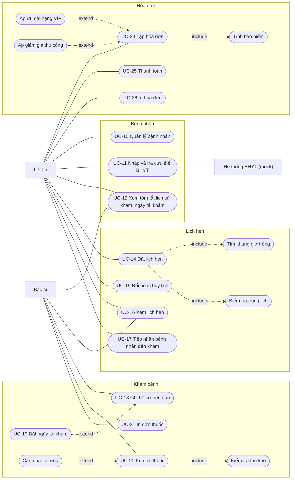
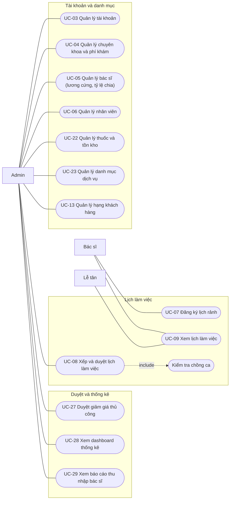
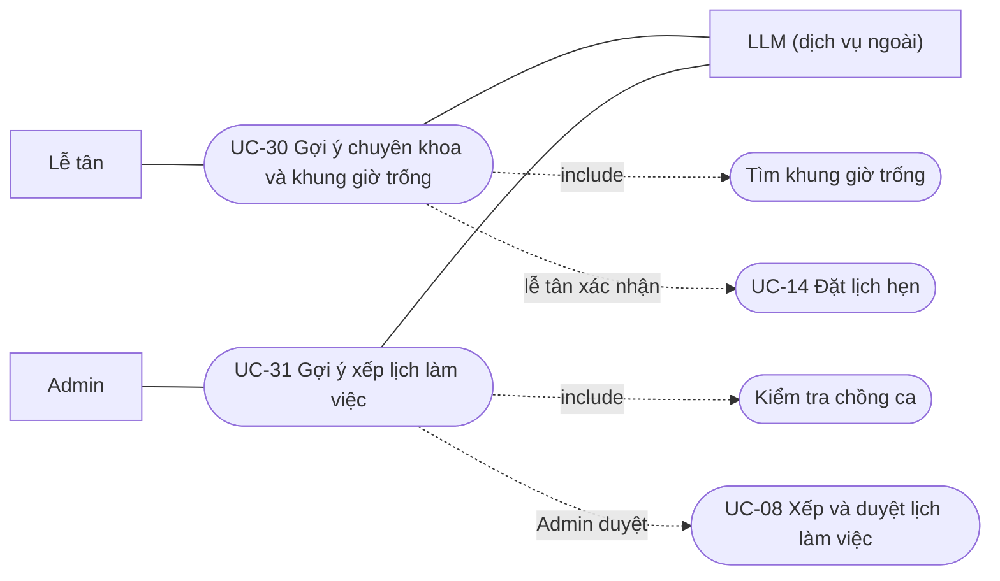

# Sơ đồ Use Case – Clinic Management System

> Trạng thái: **Nháp v0.1** (28/10/2026), bám theo `02-requirements.md` v0.3. Sơ đồ viết bằng Mermaid (hiển thị trực tiếp trên GitHub). Nếu thầy yêu cầu UML chuẩn thì vẽ lại bằng draw.io/StarUML dựa trên bảng ở mục 3.

## 1. Tác nhân

| Tác nhân | Loại | Mô tả |
|---|---|---|
| Admin | Chính | Chủ đầu tư/quản lý: danh mục, nhân sự, lịch làm việc, duyệt giảm giá, thống kê |
| Bác sĩ | Chính | Đăng ký lịch rảnh, khám, ghi hồ sơ, kê đơn |
| Lễ tân | Chính | Tiếp nhận, đặt lịch, lập hóa đơn, thu tiền |
| Hệ thống BHYT | Phụ (ngoài) | Tra cứu thẻ BHYT (đồ án dùng bản mock) |
| LLM | Phụ (ngoài) | Dịch vụ mô hình ngôn ngữ cho trợ lý AI (mở rộng) |

Mọi tác nhân chính đều dùng UC-01 Đăng nhập và UC-02 Đổi mật khẩu/đăng xuất (không vẽ lại trong từng sơ đồ).

## 2. Sơ đồ

### 2.1. Vận hành khám bệnh (Lễ tân, Bác sĩ)

### 2.2. Quản trị và lịch làm việc (Admin, Bác sĩ)

### 2.3. Trợ lý AI (mở rộng)

## 3. Danh sách use case

| ID | Use case | Tác nhân | Yêu cầu liên quan | Ưu tiên |
|---|---|---|---|:-:|
| UC-01 | Đăng nhập | Tất cả | AUTH-01 → 03 | P1 |
| UC-02 | Đổi mật khẩu, đăng xuất | Tất cả | AUTH-04 | P2 |
| UC-03 | Quản lý tài khoản | Admin | AUTH-05, STF-03 | P1 |
| UC-04 | Quản lý chuyên khoa và phí khám | Admin | SPC-01 → 04 | P1 |
| UC-05 | Quản lý bác sĩ (lương cứng, tỷ lệ chia) | Admin | STF-01, STF-04 | P1 |
| UC-06 | Quản lý nhân viên | Admin | STF-02 | P1 |
| UC-07 | Đăng ký lịch rảnh | Bác sĩ | SCH-01, SCH-05 | P1 |
| UC-08 | Xếp và duyệt lịch làm việc | Admin | SCH-02 → 04, SCH-07 | P1 |
| UC-09 | Xem lịch làm việc | Bác sĩ, Lễ tân | SCH-05, SCH-06 | P1 |
| UC-10 | Quản lý bệnh nhân | Lễ tân, Admin | PAT-01 → 06, PAT-08 | P1 |
| UC-11 | Nhập và tra cứu thẻ BHYT | Lễ tân; Hệ thống BHYT | PAT-07, PAT-09 | P1 (nhập), P2 (tra cứu) |
| UC-12 | Xem tóm tắt lịch sử khám, ngày tái khám | Lễ tân, Bác sĩ, Admin | REC-02, REC-06, REC-07 | P1 |
| UC-13 | Quản lý hạng khách hàng | Admin | PAT-10, INV-11 | P2 |
| UC-14 | Đặt lịch hẹn | Lễ tân | APT-01 → 04, APT-09 | P1 |
| UC-15 | Đổi hoặc hủy lịch | Lễ tân | APT-06 | P1 |
| UC-16 | Xem lịch hẹn | Lễ tân, Bác sĩ, Admin | APT-05, APT-08 | P1 |
| UC-17 | Tiếp nhận bệnh nhân đến khám | Lễ tân | APT-07 | P1 |
| UC-18 | Ghi hồ sơ bệnh án | Bác sĩ | REC-01, REC-03, REC-04 | P1 |
| UC-19 | Đặt ngày tái khám | Bác sĩ | REC-05 | P1 |
| UC-20 | Kê đơn thuốc | Bác sĩ | RX-01 → 03, RX-05, RX-06 | P1 |
| UC-21 | In đơn thuốc | Bác sĩ | RX-04 | P1 |
| UC-22 | Quản lý thuốc và tồn kho | Admin | MED-01 → 04 | P1 |
| UC-23 | Quản lý danh mục dịch vụ | Admin | INV-10 | P1 |
| UC-24 | Lập hóa đơn | Lễ tân | INV-01, 02, 04, 11 | P1 |
| UC-25 | Thanh toán | Lễ tân | INV-05, 06, 09 | P1 |
| UC-26 | In hóa đơn | Lễ tân | INV-08 | P1 |
| UC-27 | Duyệt giảm giá thủ công | Admin | INV-03 | P2 |
| UC-28 | Xem dashboard thống kê | Admin | DSH-01 → 05 | P1 |
| UC-29 | Xem báo cáo thu nhập bác sĩ | Admin | STF-05 | P2 |
| UC-30 | Gợi ý chuyên khoa và khung giờ trống | Lễ tân; LLM | AI-01 → 06 | P2 |
| UC-31 | Gợi ý xếp lịch làm việc | Admin; LLM | AI-07 → 09 | P3 |

## 4. Đặc tả các use case chính

### UC-07/08 Đăng ký, xếp và duyệt lịch làm việc
- **Tác nhân:** Bác sĩ (đăng ký), Admin (xếp, duyệt)
- **Tiền điều kiện:** đã đăng nhập; bác sĩ đã có chuyên khoa
- **Luồng chính:**
  1. Bác sĩ chọn ngày, giờ bắt đầu, giờ kết thúc rồi gửi đăng ký lịch rảnh (trạng thái *Chờ duyệt*).
  2. Admin mở màn hình xếp lịch, xem tổng hợp đăng ký theo ngày và chuyên khoa.
  3. Admin xếp ca cho từng bác sĩ (có thể chỉnh giờ so với đăng ký).
  4. Hệ thống kiểm tra chồng ca của cùng bác sĩ (SCH-04).
  5. Admin duyệt; ca chuyển sang *Đã xếp*; bác sĩ và lễ tân thấy lịch chính thức.
- **Luồng thay thế:** 4a. Chồng ca → báo lỗi, Admin sửa. 5a. Admin từ chối đăng ký → bác sĩ thấy trạng thái *Từ chối*. 5b. Bác sĩ gửi yêu cầu đổi/hủy ca đã duyệt (SCH-07) → Admin duyệt; ca đã có lịch hẹn phải xử lý trước.
- **Hậu điều kiện:** ca *Đã xếp* cho phép đặt lịch hẹn trong khung giờ đó (BR-16).

### UC-14 Đặt lịch hẹn
- **Tác nhân:** Lễ tân
- **Tiền điều kiện:** đã đăng nhập; bệnh nhân đã có hồ sơ (hoặc tạo mới qua UC-10)
- **Luồng chính:**
  1. Lễ tân chọn bệnh nhân, chuyên khoa (hoặc bác sĩ) và ngày.
  2. Hệ thống hiển thị khung giờ trống của các bác sĩ (include: Tìm khung giờ trống).
  3. Lễ tân chọn bác sĩ, giờ bắt đầu, thời lượng (bội số 15 phút, mặc định 20) và lý do khám.
  4. Hệ thống kiểm tra trùng lịch và giờ làm việc trong một transaction (include: Kiểm tra trùng lịch).
  5. Hệ thống lưu lịch hẹn, trạng thái *Đã đặt*; hiển thị đánh dấu tái khám nếu có.
- **Luồng thay thế:** 4a. Khoảng giờ giao nhau với lịch khác hoặc ngoài giờ làm việc → báo lỗi, quay lại bước 2. 4b. Hai lễ tân đặt cùng lúc → người sau bị từ chối.
- **Hậu điều kiện:** lịch hẹn xuất hiện trong lịch của bác sĩ (APT-05).

### UC-18/19/20 Khám, ghi hồ sơ, đặt tái khám, kê đơn
- **Tác nhân:** Bác sĩ
- **Tiền điều kiện:** bệnh nhân đã được tiếp nhận (UC-17), lịch hẹn ở trạng thái *Đã đến*
- **Luồng chính:**
  1. Bác sĩ chọn bệnh nhân từ danh sách chờ khám, xem lịch sử khám (UC-12).
  2. Bác sĩ nhập triệu chứng, chẩn đoán, ghi chú (UC-18).
  3. Bác sĩ đặt ngày tái khám dự kiến nếu cần (UC-19, extend).
  4. Bác sĩ kê đơn: chọn thuốc, số lượng, liều dùng (UC-20).
  5. Hệ thống kiểm tra tồn kho (include) và cảnh báo nếu thuốc trùng dị ứng đã ghi nhận (extend).
  6. Hệ thống lưu hồ sơ và đơn thuốc, trừ tồn kho trong cùng transaction; lịch hẹn chuyển *Đã khám*.
- **Luồng thay thế:** 5a. Số lượng vượt tồn → không cho lưu, bác sĩ giảm số lượng hoặc đổi thuốc. 5b. Có cảnh báo dị ứng → bác sĩ đổi thuốc hoặc xác nhận tiếp tục.
- **Hậu điều kiện:** lượt khám có hồ sơ và (nếu có) đơn thuốc, sẵn sàng lập hóa đơn.

### UC-24/25 Lập hóa đơn và thanh toán
- **Tác nhân:** Lễ tân (Admin duyệt giảm giá thủ công)
- **Tiền điều kiện:** lượt khám đã hoàn tất (UC-18)
- **Luồng chính:**
  1. Lễ tân mở hóa đơn của lượt khám; hệ thống lấy phí khám theo chuyên khoa, dịch vụ đã dùng, tiền thuốc.
  2. Hệ thống tính bảo hiểm theo mức hưởng của thẻ trên các khoản thuộc danh mục BHYT chi trả.
  3. Hệ thống áp ưu đãi hạng VIP (nếu có) trên phần bệnh nhân tự trả.
  4. Lễ tân nhập giảm giá thủ công (nếu có, kèm lý do) → chờ Admin duyệt (UC-27).
  5. Hệ thống hiển thị số tiền bệnh nhân phải trả = tổng − bảo hiểm − ưu đãi hạng − giảm giá thủ công.
  6. Lễ tân ghi nhận thanh toán (tiền mặt/chuyển khoản), hóa đơn chuyển *Đã thanh toán*; in hóa đơn (UC-26).
- **Luồng thay thế:** 2a. Thẻ hết hạn hoặc chưa có thẻ → bỏ qua bảo hiểm. 4a. Admin từ chối giảm giá → hóa đơn tính lại không có giảm giá.
- **Hậu điều kiện:** hóa đơn đã thanh toán không được sửa (BR-09); doanh thu được tính vào thống kê.

### UC-30 Gợi ý chuyên khoa và khung giờ trống (mở rộng)
- **Tác nhân:** Lễ tân; LLM
- **Tiền điều kiện:** đã đăng nhập; danh mục chuyên khoa và lịch làm việc đã có
- **Luồng chính:**
  1. Lễ tân nhập mô tả triệu chứng (không gồm tên, SĐT bệnh nhân).
  2. Trợ lý đề xuất chuyên khoa phù hợp trong danh mục.
  3. Trợ lý gọi hàm tìm khung giờ trống và liệt kê các bác sĩ còn lịch.
  4. Hệ thống hiển thị gợi ý kèm dòng "gợi ý tham khảo, không thay thế chẩn đoán của bác sĩ".
  5. Lễ tân chọn một gợi ý và chuyển sang UC-14 để đặt lịch.
- **Luồng thay thế:** 2a. Không xác định được chuyên khoa → trợ lý đề nghị lễ tân chọn thủ công. 3a. Không còn khung giờ trống → đề xuất ngày khác.
- **Hậu điều kiện:** không có dữ liệu nào bị thay đổi cho đến khi lễ tân xác nhận đặt lịch (AI-05).
